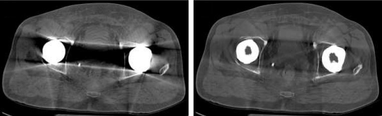

<br>
<sub>*Adapted from Wellenberg et al., Skeletal Radiology 48:1775 (2019) [[DOI](https://doi.org/10.1007/s00256-019-03206-z)] · [CC BY 4.0](https://creativecommons.org/licenses/by/4.0/)*</sub>

# MAR ILS Dataset Generator and Evaluation Framework

[](LICENSE.md)


## Contents

[**Overview**](#overview) |
[**Setup**](#setup) |
[**Try It**](#try-it) |
[**Key Parameters**](#key-parameters) |
[**Repository Layout**](#repository-layout) |
[**References**](#references) |
[**Citation**](#citation) |
[**License**](#license) |
[**Contact**](#contact)

Version history and release details are on the [Releases page](https://github.com/cdc15000/MAR-ILS-Dataset-Generator/releases). The [wiki](https://github.com/cdc15000/MAR-ILS-Dataset-Generator/wiki) explains the method in more depth.

---

## Overview

This repository is the reference software for a proposed ASTM test method, **ASTM WKXXXXX**: *Standard Test Method for Evaluation of Metal Artifact Reduction (MAR) Performance in Tomographic Imaging Systems Using a Model Observer*. It also supports the interlaboratory study (ILS) that will measure the method's precision under ASTM E691.

The method follows the framework published by FDA researchers in Vaishnav et al., *Medical Physics* 47(8), 2020. It provides:

1. a simulated CT dataset of a head phantom with metal implants;
2. a reference reconstruction;
3. a model observer that scores how well a faint lesion can be detected;
4. two reference MAR methods with known effects, used as controls.

### What the Test Measures

The test asks one question: **does the MAR method make a faint lesion near metal easier or harder to detect?**

A channelized Hotelling observer, a mathematical model of a reader, scores lesion detectability as an area under the ROC curve (AUC). It does so on images without MAR and on images with the laboratory's MAR. The result is

**ΔAUC∞ = AUC∞ with MAR − AUC∞ without MAR**

* **ΔAUC∞ > 0:** the MAR method made the lesion easier to detect.
* **ΔAUC∞ < 0:** it made the lesion harder to detect.

The ∞ means the AUC is extrapolated to an unlimited number of training images, so the result does not depend on how many images were used. The result is reported at three lesion contrasts.

### What a Laboratory Does

1. **Download the dataset** from Zenodo and verify the SHA-256 checksums.
2. **Apply your MAR method** to every sinogram in the dataset. If your method works on images rather than sinograms, apply it to the supplied no-MAR images instead.
3. **Reconstruct** the corrected sinograms with the supplied reference reconstruction.
4. **Write each image as DICOM**, 512 × 512 pixels, with Metal Artifact Reduction Applied (0018,9391) set to YES.
5. **Score** your images with the reference observer software.
6. **Report** ΔAUC∞ at each contrast level on the ILS return form.

No CT scanner is needed; the test is entirely computational. The ILS protocol, the return form and the dataset will be sent to participating laboratories by the ILS coordinator. The dataset will be published under DOI [10.5281/zenodo.23144489](https://doi.org/10.5281/zenodo.23144489).

---

## Setup

### Requirements

* Python 3.11 or newer
* Numba, which the reconstruction requires
* About 50 GB of free disk for the full ILS dataset
* 16 GB of RAM recommended
* macOS, Linux or Windows

### Installation

```bash
git clone https://github.com/cdc15000/MAR-ILS-Dataset-Generator.git
cd MAR-ILS-Dataset-Generator

python3.11 -m venv mar-ils
source mar-ils/bin/activate

pip install -r requirements.txt
pip install numba
```

### Check the installation

```bash
python -m pytest tests/test_v9.py -q
```

All tests should pass.

---

## Try It

The two commands below simulate a small set of images, apply the two reference MAR methods, and score them. They take about 4 to 5 minutes on a recent 8-core computer (about twice as long on 4 cores) and need about 2 GB of memory. The full test uses 1000 training and 1000 test images per class.

```bash
# Simulate the scored region for no MAR (fbp), MAR 1 and MAR 2
python generator_v9_0_0.py --out roi.npz --dose 1e6 --amplitude 1.025 \
    --lump-scale 0.0588 --n-train 100 --n-test 100 \
    --methods fbp mar1 mar2 --tau-counts 1124 --tau-mu 1.953

# Compute AUC∞ for each method and ΔAUC∞ against no MAR
python run_cho_analysis_v9_0.py roi.npz --out cho.json
```

You should see output like this:

```
fbp   AUC_inf 0.6476 ± 0.0190  (resub 0.6288, holdout 0.6664)
mar1  AUC_inf 0.8646 ± 0.0049  (resub 0.8603, holdout 0.8690)
mar2  AUC_inf 0.8724 ± 0.0154  (resub 0.8571, holdout 0.8877)
ΔAUC_inf mar1: +0.2171
ΔAUC_inf mar2: +0.2248
```

ΔAUC∞ for MAR 2 should be roughly +0.2. The full test gives +0.238 at this level. With only 100 images per class the results are rough, and the resubstitution and hold-out values can come out in either order; at the full 1000 images per class, resubstitution is the higher of the two.

---

## Key Parameters

| Item | Value |
|---|---|
| Phantom | Head phantom of Vaishnav et al.: skull, iron dental fillings, cochlear and deep-brain implants, and a rotating textured inset |
| Lesion | 10 mm disk at the phantom centre |
| Contrast levels | 1.020, 1.025 and 1.030 times the background |
| Scan | Fan beam, 120 kV, 984 views, 888 detector channels |
| Dose | 1 × 10⁶ photons per detector channel per view |
| Image | 512 × 512 pixels over a 30 cm field of view |
| Scored region | 121 × 121 pixels at the image centre |
| Observer | Channelized Hotelling observer, 10 dense difference-of-Gaussians channels |
| Images | 1000 training and 1000 test images per class and level |
| Improving control | MAR 2: metal found in the image, then the affected sinogram data interpolated |
| Degrading control | MAR 1: metal found by a fixed sinogram threshold, run at a dose where it fails |

In the developer's validation on five independent datasets, MAR 2 gave ΔAUC∞ of +0.215, +0.238 and +0.254 at the three levels, and MAR 1 at its failing dose gave −0.061. ΔAUC∞ varied by 0.004 to 0.008 (standard deviation) from dataset to dataset.

---

## Repository Layout

| Path | Contents |
|---|---|
| `generator_v9_0_0.py` | Dataset simulation |
| `run_cho_analysis_v9_0.py` | Observer scoring |
| `mar_ils_core/vaishnav_phantom.py` | Phantom definition |
| `mar_ils_core/vaishnav_sim.py` | Scan simulation and reference reconstruction |
| `mar_ils_core/ddog.py`, `cho_v9.py` | Observer channels and AUC∞ |
| `mar_ils_core/mar_v9.py` | Reference MAR methods |
| `tests/` | Automated tests |
| `legacy/`, `*_v7_*`, `*_v8_*` | Earlier, superseded versions, kept for the record |

---

## References

1. **Vaishnav, J.Y., Ghammraoui, B., Leifer, M., Zeng, R., Jiang, L., and Myers, K.J.** "CT metal artifact reduction algorithms: Toward a framework for objective performance assessment." *Medical Physics* 47(8):3344–3355, 2020. [[DOI](https://doi.org/10.1002/mp.14231)]

2. **Abbey, C.K., and Barrett, H.H.** "Human- and model-observer performance in ramp-spectrum noise: effects of regularization and object variability." *Journal of the Optical Society of America A* 18(3):473–488, 2001. [[PMC](https://pmc.ncbi.nlm.nih.gov/articles/PMC2943344/)]

3. **Gjesteby, L., De Man, B., Jin, Y., Paganetti, H., Verburg, J., Giantsoudi, D., and Wang, G.** "Metal Artifact Reduction in CT: Where Are We After Four Decades?" *IEEE Access* 4:5826–5849, 2016. [[DOI](https://doi.org/10.1109/ACCESS.2016.2608621)]

4. **Barrett, H.H., and Myers, K.J.** *Foundations of Image Science*, Chapter 14, Image Quality. Wiley-Interscience, 2004.

---

## Citation

> Cocchiaraley, C.D. *MAR ILS Dataset Generator and Evaluation Framework*, v9.0.0. ASTM Work Item WKXXXXX: Standard Test Method for Evaluation of Metal Artifact Reduction (MAR) Performance in Tomographic Imaging Systems Using a Model Observer. https://github.com/cdc15000/MAR-ILS-Dataset-Generator

The reference dataset will be citable at https://doi.org/10.5281/zenodo.23144489 once the Zenodo record is published.

---

## License

The code and documentation are released under the **Apache License, Version 2.0**; see [`LICENSE.md`](LICENSE.md).

The figure at the top of this page is reproduced from Wellenberg et al. 2019 under [CC BY 4.0](https://creativecommons.org/licenses/by/4.0/) and is not covered by the Apache license.

Change control for normative parameters is described in [`GOVERNANCE.md`](GOVERNANCE.md).

---

## Contact

**Christopher D. Cocchiaraley**, Consumer Member, ASTM International Committee F04  
Executor of the Estate of Veronica M. Cocchiaraley  
ORCID: [0009-0006-4995-566X](https://orcid.org/0009-0006-4995-566X)
